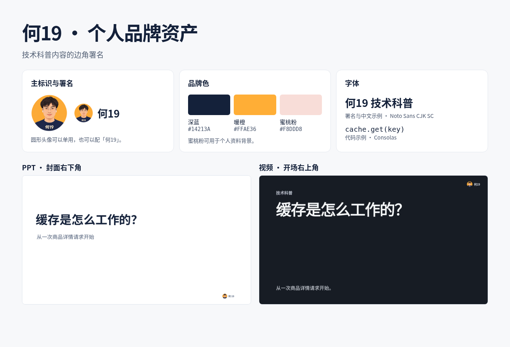

# 何19个人品牌

用于 PPT、视频和个人资料的「何19」署名。圆形头像可单独使用，也可和「何19」并排。

[查看使用规范](BRAND-GUIDE.md)，包含 PPT 和视频的尺寸、位置、时机与发布前检查。

## 完整素材包

[打开素材目录、下载链接和使用说明](kit/README.md) · [预览横竖屏模板](previews/kit-overview.png) · [预览 PPT 版式](previews/kit-ppt.png)

## 品牌总览与样例

| 资产 | 文件 |
| --- | --- |
| 品牌资产总览 | [PNG](output/he19-brand-assets.png) |
| 圆形头像 | [透明 PNG](output/he19-avatar-preview.png) |
| 浅底署名 | [透明 PNG](output/he19-signature-light-bg.png) |
| 深底署名 | [透明 PNG](output/he19-signature-dark-bg.png) |
| PPT 样板 | [可编辑 PPTX](output/he19-cache.pptx) · [五页预览](previews/ppt-overview.png) |
| 视频样片 | [19 秒 MP4](output/he19-cache.mp4) · [关键帧预览](previews/video-keyframes.png) |

样板以「缓存是怎么工作的？」为例。PPT 只在封面和结尾右下角署名。视频只在开场右上角短暂署名。示例中使用的是可从工作区取到的试排版头像。

[配色、字体与摆放](source/video/DESIGN.md) · [PPT 源文件](source/make_ppt.py) · [视频 HTML](source/video/index.html) · [视频渲染脚本](source/render_he19.py)
