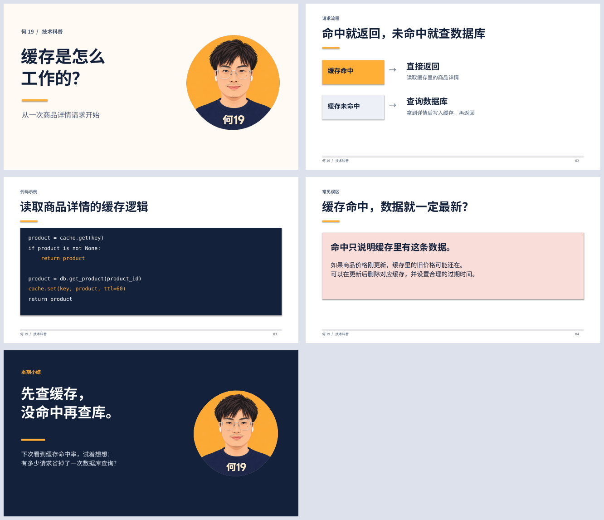

# 何19个人品牌

以「缓存是怎么工作的？」为例，展示同一套个人形象和配色在技术 PPT 与短视频中的用法。

## 样板

- [可编辑 PPT](output/he19-cache.pptx) · 5 页
- [视频样片](output/he19-cache.mp4) · 19 秒，无旁白
- [透明底头像](output/he19-avatar-preview.png) · 用于这次试排的早期版本

## 源文件

[配色与字体](source/video/DESIGN.md) · [PPT 生成脚本](source/make_ppt.py) · [视频 HTML](source/video/index.html) · [视频渲染脚本](source/render_he19.py)

`drafts/` 保存工作区现有的角色和应用概念图。
